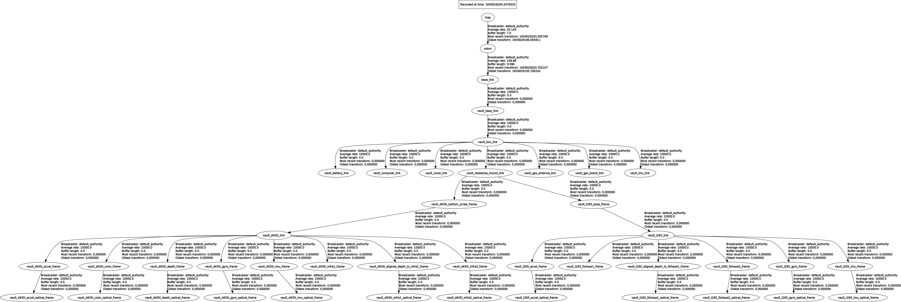
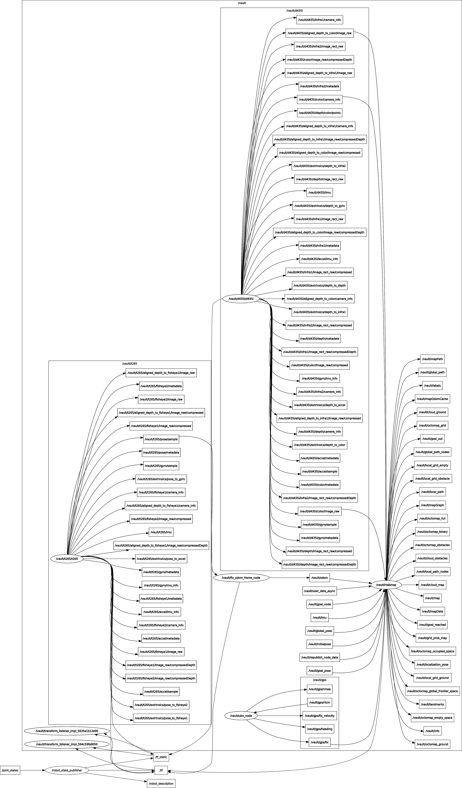

# VAULT (Visual and Autonomous Localization Kit)

<p align="center">
  
</p>

## Table of Contents

1. [Installation](#installation)
2. [Usage](#usage)

## Installation

Install the depebndencies:

- [librealsense](https://github.com/IntelRealSense/librealsense) [v2.50.0](https://github.com/IntelRealSense/librealsense/releases/tag/v2.50.0)

```shell
git clone https://github.com/IntelRealSense/cd.git
cd librealsense
git checkout v2.50.0
mkdir build
cd build
cmake
make
sudo make install
```

- [realsense-ros](https://github.com/IntelRealSense/realsense-ros) [3.2.3](https://github.com/IntelRealSense/realsense-ros/releases/tag/3.2.3)
- [Foxglove](https://foxglove.dev/download)

Then, clone and compile the repo:

```shell
$ cd ~/ros2_ws/src
$ git clone https://github.com/mgonzs13/VAULT.git
$ git clone https://github.com/mgonzs13/ubx_ros
$ pip3 install -r VAULT/requirements.txt
$ cd ~/ros2_ws
$ rosdep install --from-paths src -r -y
$ colcon build
```

### Assigning ttyUSB

You can assign a ttyUSB to each serial:

```shell
$ sudo udevadm info --query=property --name=/dev/ttyUSB0 | grep SERIAL
ID_SERIAL=Silicon_Labs_HandsFree_IMU_USB_to_UART_Bridge_Controller_0001
ID_SERIAL_SHORT=0001
$ sudo udevadm info --query=property --name=/dev/ttyACM0 | grep SERIAL
ID_SERIAL=u-bloxAG-_www.u-blox.com_u-blox_GNSS_receiver
Parece que se desconecta el ublox cada x tiempo
$ sudo nano /etc/udev/rules.d/99-usbserial.rules
# add the following lines
ACTION=="add",ENV{ID_BUS}=="usb",ENV{ID_SERIAL}=="Silicon_Labs_HandsFree_IMU_USB_to_UART_Bridge_Controller_0001",SYMLINK+="ttyUSB0"
ACTION=="add",ENV{ID_BUS}=="usb",ENV{ID_SERIAL}=="u-bloxAG-_www.u-blox.com_u-blox_GNSS_receiver",SYMLINK+="ttyACM0"

```

## Usage

### Running VAULT

Define the following environment variables:

```shell
# Ntrip
export NTRIP_HOST=YOUR_HOST
export NTRIP_PORT=YOUR_PORT
export NTRIP_MOUNTPOINT=YOUR_POINT
export NTRIP_USER=YOUR_USER
export NTRIP_PASSWORD=YOUR_PASSWORD

# ROS 2
export ROS_DOMAIN_ID=13
export RMW_IMPLEMENTATION=rmw_fastrtps_cpp

# Sensors
export FIX_T265_ODOM=True
export PUBLISH_T265_ODOM_TF=False
export FIX_D435i_IMU=False

# Visual SLAM
export PUBLISH_VISUAL_SLAM_TF=True
export USE_T265=False
export USE_GPS=False

# EKF
export RUN_EKF=True
export RUN_DUAL_EKF=False

# Visual odometry
export RUN_RDGD_ODOMETRY=False
export RUN_STEREO_ODOMETRY=False
export RUN_ICP_ODOMETRY=False
```

```shell
$ ros2 launch vault_bringup vault.launch.py
```

### Using a Linux service

[See vault_service README.](./vault_service/README.md)

<!-- ## Docs

### Frames



### Rosgraph

 -->
